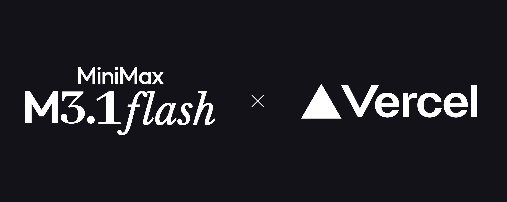

# Campaign Studio

A film studio that decodes a social campaign's creative structure and creates an original campaign for any brand. No brand kit, mascot, product claims or finished footage is preloaded. M3.1 develops the breakdown, treatments and shot plans; MiniMax H3 generates video; Vercel eve runs the director agent and durable render waits.

Run locally with SQLite and local media, or deploy your own protected studio on Vercel with Neon and private Blob storage. See [hosted setup](docs/hosted-starter.md). Each installation is one shared studio for its trusted operators, not a multi-tenant service.

Each person cloning or deploying the template supplies their own MiniMax API keys and model IDs. The template connects directly to the preconfigured MiniMax endpoints; no author-owned credentials or AI Gateway account are included or required.

## Run locally

Clone this repository and run the following from its root. Use Node.js 24 (`.nvmrc`). FFmpeg and ffprobe are bundled for supported platforms; you can instead install them locally and set `FFMPEG_PATH` / `FFPROBE_PATH` if needed.

```sh
nvm install
nvm use
npm install
cp .env.example .env.local
```

Before starting, add your own credentials and model IDs to `.env.local`. The defaults below preserve the demo's model configuration; choose IDs and keys your MiniMax account is authorized to use. Text and video keys may differ:

```dotenv
MINIMAX_TEXT_API_KEY=your_text_key
MINIMAX_TEXT_MODEL=MiniMax-M3.1-Flash-Preview
MINIMAX_VIDEO_API_KEY=your_video_key
MINIMAX_VIDEO_MODEL=MiniMax-H3
```

Only text and video model access is required. Storyboarding uses a written shot plan; there is no image-generation step or image-model key to configure.

```sh
npm run dev
```

Open [the studio](http://127.0.0.1:3000). The app binds to loopback. Restart after changing configuration. Attach a reference clip and your brand images, then describe the film you want. No search credentials are needed for this first run.

| Capability | Configuration |
| --- | --- |
| Director and specialists | `MINIMAX_TEXT_API_KEY`, `MINIMAX_TEXT_MODEL` |
| Video generation | `MINIMAX_VIDEO_API_KEY`, `MINIMAX_VIDEO_MODEL` |
| Optional X discovery/import | `X_API_BEARER_TOKEN` or `TWITTERAPI_IO_API_KEY`; select with `X_SEARCH_PROVIDER` |
| Optional broader web research | `EXA_API_KEY` |
| Optional local TikTok import | Python 3, then `npm run setup:video-import` |
| Hosted persistence | Neon database + private Vercel Blob; follow [hosted setup](docs/hosted-starter.md) |

The preconfigured text endpoint is `https://api.minimax.io/anthropic/v1`; the video endpoint is `https://api.minimax.io` using `/v2/video_generation`. Keep these MiniMax endpoints for normal setup. `MINIMAX_TEXT_MODEL` configures the director and all three specialists. `MINIMAX_VIDEO_MODEL` configures new video submissions and must support the H3/V2 request format. The browser receives configuration status, never provider keys. A template-wide shared password is not required for local use.

## Try it: Space Bunny — Deploy a Garden

Make a playful MiniMax M3.1 Flash × Vercel launch film using the example below. These are optional example attachments: the app still starts with an empty campaign and works with any brand.

[Download all four assets as a ZIP](docs/examples/deploy-a-garden/deploy-a-garden-assets.zip), or open the individual files below and download their originals. After cloning the repo, the files are also in `docs/examples/deploy-a-garden/`.

| Asset | Preview | How to use it |
| --- | --- | --- |
| [Space Bunny reference](docs/examples/deploy-a-garden/space-bunny-reference.png) |  | Character and visual-style reference from the earlier demo film. |
| [Vercel triangle](docs/examples/deploy-a-garden/vercel-triangle.png) |  | Shape reference for Bunny's deploy button. White artwork on transparency. |
| [MiniMax M3.1 Flash × Vercel lockup](docs/examples/deploy-a-garden/minimax-m31-flash-x-vercel.png) |  | Transparent PNG for the exact logo overlay over the moving ending. |
| [Lockup preview on dark](docs/examples/deploy-a-garden/lockup-preview-dark.png) |  | Appearance reference only; use the transparent lockup for the export. |

1. Finish the MiniMax text/video setup above and open a new campaign.
2. Unzip the kit and attach the four PNGs with the paperclip, then paste the prompt below. The dark preview helps communicate the intended appearance; it should not become a full-screen end card.
3. To import the linked launch clip, configure either optional X provider. Without an X key, attach your own copy of the reference video and replace the prompt's URL paragraph with: “Use the attached video as the campaign reference; inspect its actual footage.” The four PNGs contain no video or audio.
4. Choose the imported/uploaded video when the app presents the reference selection. The director then plans, renders, reviews and exports. This runs real paid MiniMax text/video calls; no image generation is used. Watch and listen to the final MP4 before sharing it.

### Copy this prompt

```text
Create a cute, playful 20–25-second MiniMax M3.1 Flash × Vercel launch film called “Deploy a Garden.” Produce it in 16:9.

Use our original launch as inspiration: https://x.com/MiniMax_AI/status/2112111925975032241. Import and inspect the actual footage, then make an original continuation using the attached assets.

Use space-bunny-reference.png for Bunny's appearance and the tactile, warmly lit visual style. Use vercel-triangle.png as the shape reference for a deploy button. Use minimax-m31-flash-x-vercel.png as the exact transparent co-brand overlay. lockup-preview-dark.png is only an appearance preview, not footage or an end card. Treat these images as brand and character references, separately from the source video.

Space Bunny lands on a barren moon carrying a tiny glowing carrot. It plants the carrot and presses a triangular deploy button inspired by Vercel. A little sprout appears—then a wave of colorful flowers spreads across the lunar surface. Bunny bounces through the garden as the camera pulls back to reveal a blooming moon.

Make the ending part of the action: flowers and sparkling particles frame the exact MiniMax M3.1 Flash × Vercel lockup while Bunny floats past and waves. Overlay the supplied transparent lockup over the continuing footage in the final four seconds. Keep the scene moving through the final frame. No static end card, generated lettering or corner watermark.

Keep Bunny's appearance consistent, with charming tactile animation, warm lighting and a sense of discovery. Use a written shot plan only, then generate directly with H3 using the supplied references—no storyboard image generation.

If the reference has usable music, reuse a fitting excerpt without looping or repeating dialogue, and fit the edit to it. If it is shorter than the planned film, shorten the film to match. Otherwise keep H3's native sound and prompt for playful cosmic ambience with no dialogue; don't substitute a generic background track.

Once I select the initial video reference, continue through rendering, take review and final MP4 export without extra approval steps.
```

## Campaign to launch film

The main page has one prompt box. Describe the campaign and the film you want, paste a source link, or attach up to 10 clips/images per message. A campaign can retain 10 source assets and 10 source links; user-supplied brand artwork is kept separately. The director selects a valid subset for each H3 shot; the provider's per-shot media and duration limits still apply. For example: “Make a playful 20-second launch film for my sparkling tea brand. Use this video for pacing and my uploaded logo and product images for our identity.”

M3.1 interprets the request into a saved brief, develops a creative breakdown and visual direction cards, then waits for you to choose the initial source video. After that choice, it plans the sequence, renders all scenes, delegates frame review, selects usable takes and exports the film automatically. The output canvas shows actual tool activity, references, the proposed sequence, real rendered takes and the exported film. Keep directing in the same box: “Use the second idea,” “Make the opening quieter,” or “Change the ending.” The agent can select a direction from ordinary language. It chooses a sensible default when asked to make the film without further direction.

Reference selection is the only normal checkpoint. There are no required take approvals or separate export clicks. The director may make one corrective render per scene; the final take selection automatically assembles the MP4. Optional **Revise** remains available after production, and previous takes stay preserved. A failed or uncertain provider job can still require attention. Final release means the downloadable MP4, not public posting. There is no simulated progress, canned model output or generated footage shown before the provider returns it. A missing connection saves the prompt and shows setup instructions without dispatching a model request.

The agent retrieves public TikTok and X video references from full post URLs, persists the original MP4 in the configured media storage and displays source cards with attribution, publication dates and reported engagement counts. The selected X provider retrieves up to six candidates above 100,000 reported views across up to three pages per search. The M3.1 scout downloads each candidate without changing the campaign, receives an eight-frame timestamped contact sheet, and records a visual verdict with evidence. Only matched, curated candidates enter recommendations; unavailable, uncertain, caption-only and low-view candidates cannot qualify.

Retrieval words and the visual target are separate. The scout can search broader subjects, known creator feeds, or omit caption keywords entirely while retaining a visual target such as “a dog performing dance-like movements.” This makes generic-caption videos eligible for visual review, but it is bounded retrieval, not a visual index of all X videos. Sampled frames do not verify continuous motion or audio. The gallery shows review progress, match reasons and timestamped evidence. Search results are not a platform-wide trend ranking or proof of the original upload. TikTok extraction uses the official yt-dlp package and its normal public session, without using browser credentials. Install the project-local extractor with `npm run setup:video-import` for optional TikTok imports. X search supports either `X_API_BEARER_TOKEN` or `TWITTERAPI_IO_API_KEY`.

Automatic imports are limited to 32 MB and two minutes. Only exact TikTok `/@creator/video/ID` and X `/creator/status/ID` links are supported; shortened links must be expanded. Private, unavailable or blocked posts show a retrieval error instead of an invented analysis. Clip references supply up to twelve timestamped still frames, including denser opening samples. Still frames do not verify continuous movement or source audio. Explanations for engagement remain hypotheses. Campaign assets are not automatically attached to H3 generation requests.

Selecting a reference must update the actual unlocked shot prompts. Each generated shot records `sourceBasis` with the current analysis ID, inspected assets, and a concrete creative adaptation; that adaptation is included in the H3 text request. Stale plans cannot start a new render. The sequence displays these source-to-shot connections and labels whether footage is an actual H3 video input or creative inspiration. “Use this reference” asks the agent to supply the selected clip as a visual input on relevant shots; H3 media limits still apply. Existing takes are preserved and marked as earlier footage when their source plan changes.

In local development, credential access reads the current project `.env.local` so Next.js and eve's workflow worker cannot disagree because of inherited empty credentials. The agent receives connection-presence flags only, never keys. API entitlement still requires a successful provider request. `npm run dev` starts eve with `--resume` before Next.js, preserving saved conversations across restarts and keeping configuration reloads from replacing the agent process. Pending workflow recovery uses eve's retained snapshots; existing H3 task IDs remain protected from duplicate submissions.

The detailed editor is preserved at [`/studio`](http://127.0.0.1:3000/studio) for manual shot controls, recovery and production history.

**9:16 social** produces portrait H3 jobs and 1080 × 1920 MP4 exports. **16:9 widescreen** produces landscape jobs and 1920 × 1080 exports. Format is saved on each render job, and export reuse is keyed by format as well as shot choices. Existing takes are preserved; footage with a different shape is fitted and padded. No title card or logo is inserted by default.

## Optional search providers

No search key is required to make films from uploaded reference videos. With neither X nor Exa configured, attach an MP4/MOV using the paperclip and describe your campaign; the director skips scouting and analyzes your footage. For a topic-only request, it asks for a reference upload. There is no hidden browser search or shared search credential.

- `X_API_BEARER_TOKEN`: optional official X API v2 for recent search and exact post/video lookup. Recent search covers at most seven days; the scout reports the actual window. Your X account needs endpoint access and quota. Video views use `media.public_metrics.view_count`; missing counts remain unknown and cannot pass the >100K recommendation threshold. Post impressions are not substituted for video views.
- `TWITTERAPI_IO_API_KEY`: optional alternative X provider, retaining the existing 14/30-day search and importer.
- `X_SEARCH_PROVIDER=auto` (default): choose official X when its token exists, otherwise TwitterAPI.io. Set `official`, `twitterapi-io`, or `none` to pin a provider or disable X. A pinned provider with a missing key is unavailable; failures never trigger a silent paid fallback to the other provider.
- `EXA_API_KEY`: independently optional broader web research. Exa-only setups can find links but cannot import X footage or verify view counts without an X provider; upload the chosen clip instead.

Direct uploads do not require social view counts. The >100K threshold applies to the scout's recommended public trend videos. Cached imported footage remains usable after a search provider is disabled.

Official API references: [recent search](https://docs.x.com/x-api/posts/search-recent-posts) and [post lookup](https://docs.x.com/x-api/posts/lookup/introduction).

## Broader web discovery with Exa

Set `EXA_API_KEY` in the server environment to enable `search_web_references` for the director and trend scout. Social scope searches indexed X, TikTok, Instagram and YouTube pages; web scope searches campaign sites and case studies. Exa results appear under **Across the web** as research links with source dates when available. They are not watched videos, verified view counts or viral recommendations. Historical inspiration can use a wider date window and must be described as historical.

Your selected X provider handles X discovery and X metadata/video retrieval. Its existing >100K-view and visual-inspection requirements still control the verified video shortlist. Exa does not add Instagram or YouTube downloaders or remove TikTok extraction requirements. Unsupported or blocked sources need a user-supplied clip. The connected Exa app in a coding assistant is separate from the API key needed by a deployed studio.

All provider credentials stay in server environment variables. The browser receives configured/not-configured status and short-lived restricted Blob upload tokens, never provider API keys or the master Blob token. Keep the hosted instance protected; authorized operators can initiate paid provider work.

## Your brand assets

Start with an empty campaign. Attach your own product art and logos, and describe how to use them in the same prompt. The director registers those images with `set_brand_assets`, inspects them with `get_brand_assets`, and can send the actual images as H3 references. Brand images stay separate from source footage and evidence. Files are never classified using a preloaded brand fingerprint.

Default MP4 exports are clean footage with the chosen soundtrack. For an exact supplied logo, `create_cut` accepts `finish=brand-overlay` and a registered `logoAssetId`; the image fades over the final four seconds of continuing footage. No MiniMax or Vercel logos, automatic watermark, fixed product title or flower card are added. Earlier takes and exports remain preserved.

## Detailed editor controls

1. Add approved launch facts to **The brief**. Upload your own source footage and visual references in **Media library**.
2. Ask M3.1 to pitch three directions. Select a treatment; M3.1 updates the shot board without generating yet.
3. Pick a generated shot and add references from the library. Ask M3.1 to render that shot. H3’s task ID and status appear in **Activity**.
4. Review the returned take and its sampled-frame review. Play it to check motion and audio. **Accept take** selects it and locks the shot.
5. Unlock only the shot you want revised, then give a note with that shot selected. Compare the new take to the accepted take and accept it when ready.
6. Assign your real opening footage with **Use footage**. Once every source/generated shot has an accepted take, **Export film** assembles the film into a downloadable 1080p MP4. The final export uses only your requested, supplied branding. Download the last export from **Activity** or preview it with **Play last export**.

New campaigns have empty prompts and neutral scene slots until you describe your campaign. The director writes the shot sequence, then renders directly with H3 using the selected footage and supplied brand/character images. Ask for “storyboard only” or “plan only” to stop at the written plan before paid video generation, then continue in the same conversation. No generated planning images are created or automatically sent to H3. Historical storyboard images remain stored but do not block or guide new renders. There are no simulated model responses or fake generation jobs.

## What is implemented

- Prompt-first Next.js app with one text box, optional attachments, natural-language direction, actual tool activity and a visual output canvas.
- Detailed editor: brief, shot board, source library, shot inspector, takes, comparison, locking, production activity and exports.
- Campaign references, versioned creative breakdowns with timestamped evidence and hypotheses, an empty brand-agnostic starting campaign, and portrait/widescreen delivery.
- Real eve agent with M3.1 via `@ai-sdk/anthropic`, typed tools and a resumable browser conversation.
- Three declared M3.1 subagents: trend scout, reference analyst and take reviewer, each with a narrow tool set and its own eve session. The single-input studio follows their child streams and displays actual task status, tool activity and findings. Independent scouting and source analysis can run in parallel; only the director can modify plans or request renders. No child can accept or unlock takes.
- H3 V2 submission, persisted provider task IDs and durable polling through `defineWorkflowTool`.
- Local media uploads, metadata validation, reference encoding and four-frame visual inspection.
- SQLite transactions and local media for development; Neon transactions and private Blob media for hosted studios.
- Written shot planning followed by H3 generation, and FFmpeg assembly with normalized video/audio, optional supplied-logo overlays, versioned portrait/widescreen exports and range-served playback.

## Reliability and limits

Submissions reserve a unique operation in the database before calling H3. Replays reuse the saved operation. An uncertain submission blocks a new job for that shot; it does not automatically submit again. If the provider accepted a job but its response was lost, recover the task ID in the MiniMax console and attach it in **Activity**. A response lost between submission and persistence cannot be made exactly-once without provider-side idempotency.

H3 reference videos and audio must each be 2–15 seconds, with total reference duration at most 15 seconds per modality. Images and clip dimensions must match the current API limits. The studio accepts files up to 32 MB, uses inline reference data and bounds the encoded request size. Use MP4 for H3 video references; MOV is supported as source footage for assembly.

Visual review sends four timestamped still frames together in one contact sheet, so the reviewer can compare every sample in a single image. Fresh inspections start a new specialist task; clarifying an existing report can reuse its task. It does not evaluate all motion, voice intelligibility, music licensing or soundtrack quality. Perform a playback/listening pass before release. Exports use straight cuts and keep the selected footage’s native audio by default, including H3 sound, aligned to scene trims. Scenes without audio stay silent; no music is substituted. Users can instead choose an original reference recording (once by default, loop only when requested), silence, or explicitly request the legacy local synthesized instrumental score. These replacement modes exclude H3 audio. MiniMax Music is not integrated. Visual references sent to H3 are muted without modifying the original files. Audio-only revisions reuse the encoded pictures and preserve previous exports; audio checks record source provenance and duration, not a listening review.

In local mode, `.studio/` holds SQLite and media and `.eve/` holds eve’s local run state. Keep those folders for continuity. `STUDIO_DATA_DIR` can point to another absolute persistent local directory shared by both processes; do not run multiple local studios against the same directory. Hosted mode uses Neon transactions for campaign state and private Blob for media. `/tmp` is only a recoverable working cache. Uploaded files go directly to Blob before server-side validation. FFmpeg/ffprobe are packaged with the functions; a separate media service is not required for this starter. Hosted requests are admitted only when the deployment protection mode is explicitly configured. See [hosted setup](docs/hosted-starter.md).

Live M3.1 and H3 calls require your own authorized credentials. The production tests use a test-only provider fixture and real FFmpeg media; that fixture is never available as an application mode.

Arbitrary agent shell tools are disabled in this application. Run `npm audit` to check the installed dependency versions against current advisories before expanding execution capabilities.

## Checks

```sh
npm run typecheck
npm test
npm run build:agent
npm run build
```

Tests cover concurrent/replayed submissions, uncertain provider responses, locked-shot protection, candidate-take preservation, real upload/frame extraction, MP4 assembly, byte-range playback, optional search-provider selection and local API access. FFmpeg and ffprobe must be executable through the bundled binaries or configured local installation. Production media is not used by tests.

With the development server running and Playwright Chromium installed, `npm run test:browser` checks the initial editor’s save/reload flow, missing-key setup, shot inspection and responsive layout. It briefly edits and restores the brief; use it on the initial project, before producing real takes. `PLAYWRIGHT_EXECUTABLE_PATH` can point to an existing compatible Chromium installation.

## Sources

- [MiniMax text generation](https://platform.minimax.io/docs/guides/text-generation)
- [H3 create task](https://platform.minimax.io/docs/api-reference/video-generation-v2-create)
- [H3 query task](https://platform.minimax.io/docs/api-reference/video-generation-v2-query)
- [eve Next.js integration](https://eve.dev/docs/guides/frontend/nextjs)
- The exact eve and Next.js APIs are documented in their installed packages under `node_modules/eve/docs/` and `node_modules/next/dist/docs/`.
